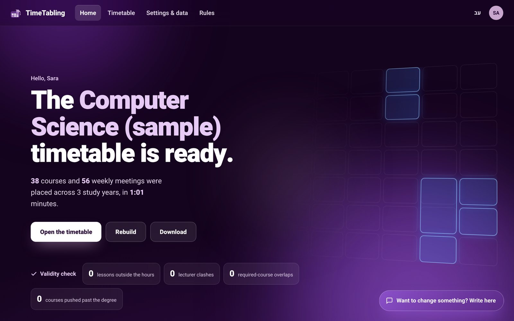
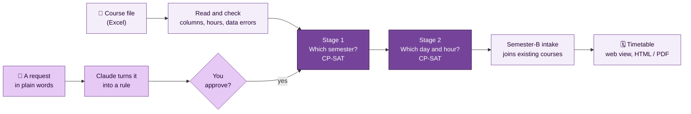
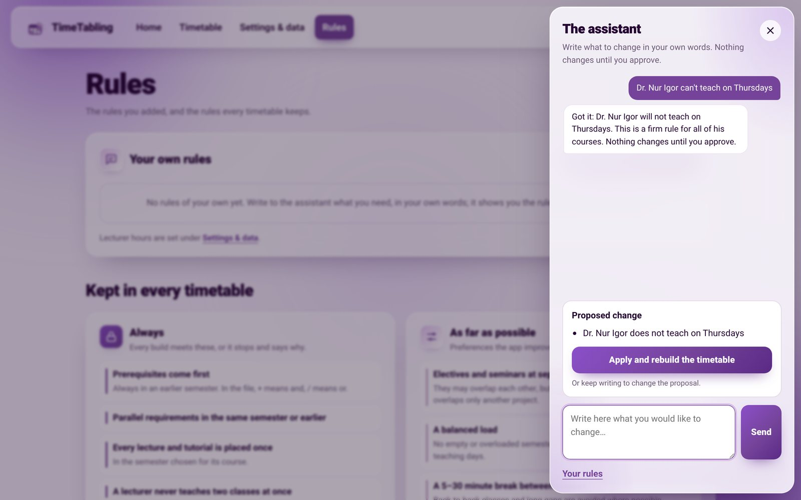
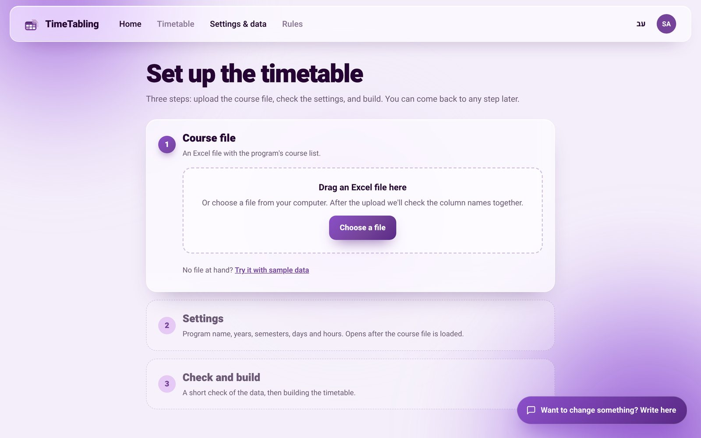
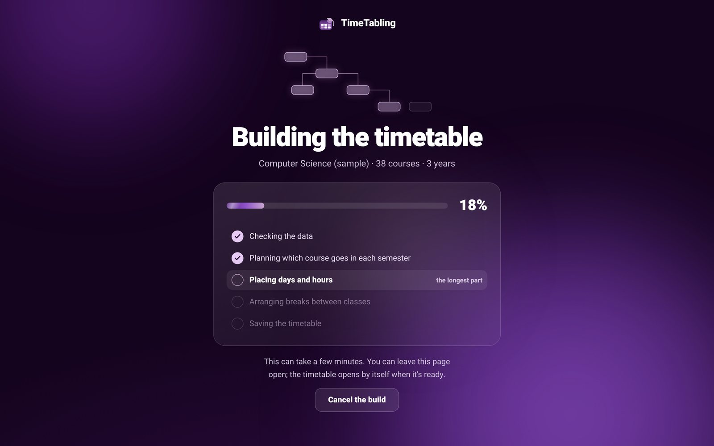
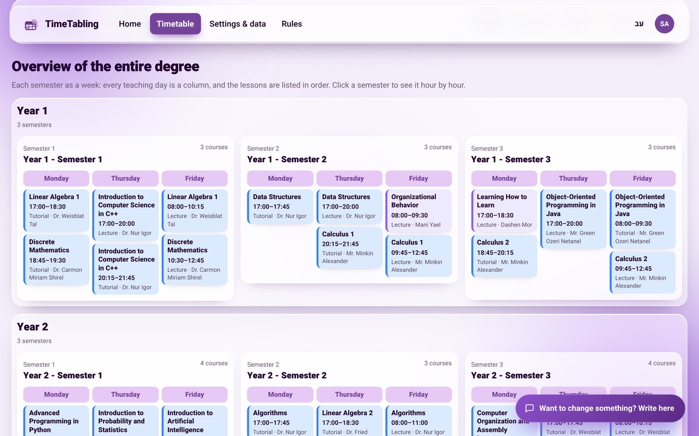
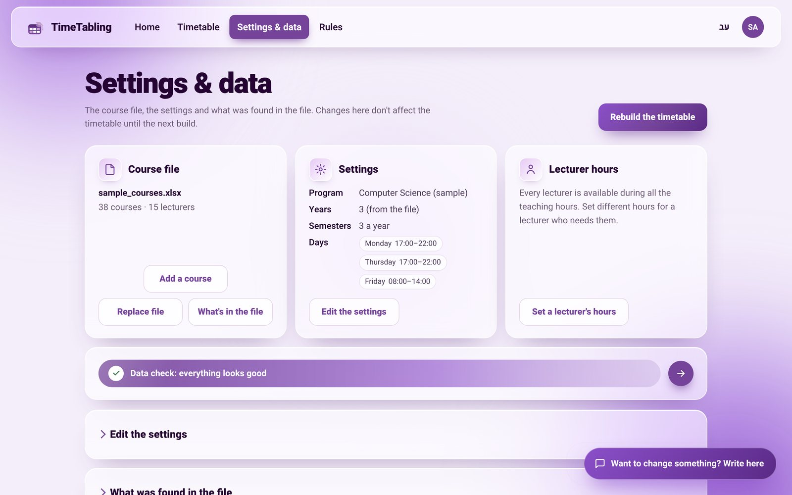
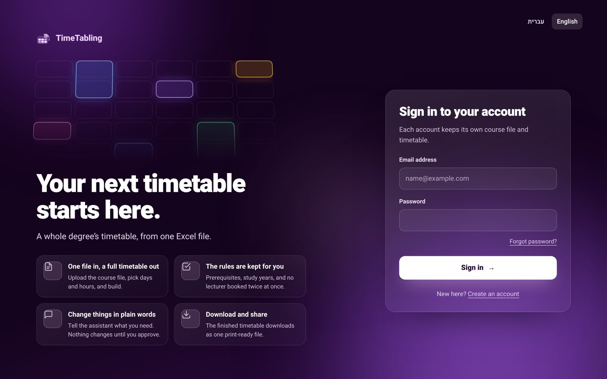
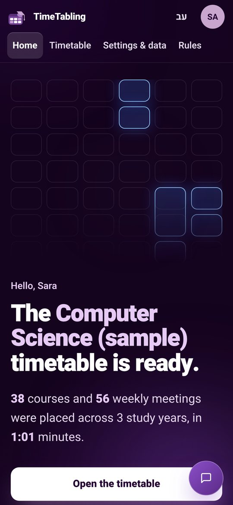
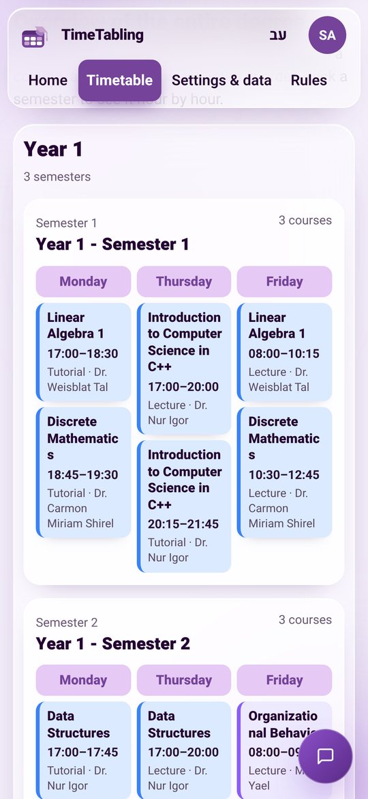

<div align="center">


# TimeTabling

**A smart system for planning study programs and scheduling courses**

One Excel course file in. A complete, valid timetable for a whole degree out, in about a minute.<br>
Change it in plain words; nothing changes until you approve.




</div>

---

## The problem

Every year an academic department builds the timetable for an entire degree: dozens of courses, lecturers and prerequisite chains, squeezed into very few teaching hours. Building it by hand in Excel is long work, and a single change (a lecturer who becomes unavailable, a new course) sets off a chain of fixes.

It is also genuinely hard. The number of ways to place the courses grows explosively with every course added, into the billions; timetabling is a known NP-hard problem, so trying every option is out of the question. General scheduling tools such as UniTime exist, but they are complex to run, don't know a degree's own rules, and need technical knowledge to set rules up.

**TimeTabling asks:** can a valid, comfortable timetable for a whole degree be built automatically, even with very little teaching time and two intakes a year, and then be changed in free language with no technical knowledge?

## The answer: yes

On the computer science department's real data, with only **3 teaching days** (Monday and Thursday 17:00–22:00, Friday 08:00–14:00 = 16 hours a week) and **two intakes** (one starting in semester A, one in semester B):

| Courses | Lecturers | Weekly meetings placed | Lecturer clashes | Courses shared by both intakes | Total run time |
|:-:|:-:|:-:|:-:|:-:|:-:|
| **38** | **15** | **65** | **0** | **32 / 38** | **≈ 100 s** |

- All 38 courses fit inside the three degree years; none was pushed to an extra year.
- Planning which semester each course goes in took **under two seconds**.
- The semester-B intake needed only **3 extra course openings** instead of a second copy of the degree.
- Every built timetable is checked again after the solve: 0 lessons outside teaching hours, 0 lecturer clashes, 0 overlapping required courses, 0 courses pushed past the degree, 0 unrecognised prerequisites.

## How it works



**Splitting the problem is the key.** A single model that decides semesters, days and hours at once is too big to solve in reasonable time. TimeTabling first decides *which semester* each course is taught in (Stage 1), then *which day and hour* each lecture and tutorial gets on a 5-minute grid (Stage 2), and finally polishes the result for comfortable breaks and round start times. Both stages are models for [Google OR-Tools CP-SAT](https://developers.google.com/optimization/cp/cp_solver), a constraint solver: you give it variables (semester, day, start time), rules it may never break, and penalties for things that are merely inconvenient, and it searches for the best placement.

<table>
<tr>
<th width="50%">Always (never broken)</th>
<th width="50%">As far as possible (penalties)</th>
</tr>
<tr valign="top">
<td>

- A prerequisite comes in an earlier semester; a parallel requirement in the same semester or earlier
- Every lecture and tutorial is placed exactly once, in its course's semester
- A lecturer never teaches two classes at once
- Required and general courses never overlap any other course
- Only inside the teaching days and hours, and inside a lecturer's own hours when set
- Each course stays in its study year, so the degree ends on time

</td>
<td>

- Breaks of 5–30 minutes between classes, not back to back and no long gaps
- A balanced load across days and semesters
- Compact teaching days and quarter-hour start times
- Electives and seminars at separate times (they may overlap only as a fallback, since no student takes all of them)
- As many courses as possible shared between the two intakes

</td>
</tr>
</table>

When no timetable fits, the app says so plainly and points at the rule or data in the way (for example, a prerequisite chain too long for its study year), instead of failing silently.

## Change it in plain words

Write what you need in Hebrew or English, the way you would tell a colleague. Claude turns the request into a structured rule, shows it to you, and the solver enforces it **only after you approve**.



<sub>An example request and the rule the assistant proposes for it.</sub>

> Dr. Nur Igor can't teach on Thursdays.

becomes


```json
{
  "kind": "placement_filter",
  "description": "Dr. Nur Igor does not teach on Thursdays",
  "hard": true,
  "scope": { "lecturers": ["Dr. Nur Igor"] },
  "forbidden_days": ["Thursday"]
}
```

The assistant understands three kinds of rules, and combines them for broader requests:

| Kind | Examples |
|---|---|
| **Placement** of courses, lecturers or study years | "only on Monday", "never after 18:00", "Data Structures in semester B" |
| **Relation** between two courses | "on different days", "before / after / in the same semester as …" |
| **Day load** | "make Wednesday lighter for second-year students", "at most 4 hours on Wednesday" |

Words like *can't, must, never, only* become rules that must hold; *prefer, try, if possible* become preferences. If a request is vague, the assistant asks one short question instead of guessing. Semester rules are applied already in Stage 1, so "move this course to semester B" moves the courses that depend on it too.

## A quick tour

The screenshots show the English interface. The app opens in Hebrew, right to left, by default; the language switch is in the top menu on every page.

<table>
<tr valign="top">
<td width="50%"><br><sub><b>Guided setup.</b> Upload the course file (or try the sample), check the settings, build.</sub></td>
<td width="50%"><br><sub><b>Building.</b> Runs in the background with live progress; it can be cancelled.</sub></td>
</tr>
<tr valign="top">
<td width="50%"><br><sub><b>The whole degree at a glance.</b> Each year in one row, each semester as a week. Click a semester to see it hour by hour.</sub></td>
<td width="50%"><br><sub><b>Settings and data.</b> The course file, teaching days and hours, lecturer hours, and what was found in the file.</sub></td>
</tr>
<tr valign="top">
<td width="50%"><br><sub><b>Accounts.</b> Each account keeps its own course file and timetable.</sub></td>
<td width="50%">

<br><sub><b>On a phone too.</b> Every page works at 390 px wide.</sub></td>
</tr>
</table>

## Features

**Getting the data in**
- **Column check.** Headers with different names are matched by known synonyms, likely typos or the column's values; you confirm once and the names are remembered.
- **Data check before every build.** Blocking problems, warnings and information, each in plain words: duplicate course IDs, prerequisites that match no course, rows that were skipped or given default hours, and more.
- **Prerequisite parser** for `A + B / C` (and / or, with parentheses), safe for names like *C++*.
- **Lecture and tutorial hours** are computed from credits and weekly hours.
- **Study years**, three ways: exactly as in the file; suggest the fewest course moves and wait for approval (the default); or move them automatically and report.

**Building**
- **Semester-B intake.** A second cohort starting in semester B joins existing courses wherever its prerequisites allow; seminars are always shared.
- **Lecturer hours.** Limit a lecturer to certain days and hours.
- **Background builds** with a progress page, cancel, and a clear report when something is in the way.
- **Your own rules** from the assistant, listed on the Rules page beside the built-in ones.

**Seeing and sharing**
- **Semester view** hour by hour, with the hours outside each day's teaching window shaded.
- **Degree overview** by year, in the course-category colours (required, elective, seminar, project, general).
- **Download** one standalone HTML file for students: pick cohort A, B or both, open it offline, print it or save it as PDF.
- **Hebrew first** (right to left) with English one click away; keyboard friendly, visible focus, reduced motion respected.

## Quick start

Requires Python 3.11 or newer.

```bash
git clone https://github.com/sarazoher/timeTabling.git
cd timeTabling
python3 -m venv .venv
source .venv/bin/activate              # Windows PowerShell: .\.venv\Scripts\Activate.ps1
python -m pip install -r requirements.txt
python timetable_frontend/app.py
```

The browser opens at **http://127.0.0.1:5000**; the app starts in Hebrew, and the switch to English is in the top corner. Create an account, then on the setup page choose **Try it with sample data** and build: the bundled computer science sample (38 courses) is ready in about a minute.

**To use the assistant**, set an [Anthropic API key](https://console.anthropic.com/) in the same terminal before starting the app. Everything else works without one.

```bash
export ANTHROPIC_API_KEY="your-key"     # Windows PowerShell: $env:ANTHROPIC_API_KEY="your-key"
export CLAUDE_MODEL="…"                 # optional: choose a model available to your account
```

## The course file

One Excel sheet, one row per course. The column headers follow the sample file, [`timetable_frontend/sample/sample_courses.xlsx`](timetable_frontend/sample/sample_courses.xlsx); if yours are named differently, the column check matches them and asks you to confirm.

| Field | Needed |
|---|:-:|
| Course ID | ✔ |
| Course name | ✔ |
| Study year | ✔ |
| Credits | ✔ |
| Course category: required, general, elective, seminar or project (written as in the sample file) | ✔ |
| Prerequisites: `+` means and, `/` means or | ✔ |
| Parallel requirements | |
| Lecturer | |
| Weekly hours | |
| Lesson type: lecture only, or lecture and tutorial | |

Optional fields that are missing get a default, and the data check lists them.

<details>
<summary><b>How lecture and tutorial hours are calculated</b></summary>

The weekly-hours column is in half-hour units, so a course meets `W = 2 × S` hours a week. For lessons marked lecture and tutorial, the credits `C` split those hours:

```text
W = 2 × S
lecture hours  = 2 × C − W
tutorial hours = 2 × (W − C)
```

Other lesson types meet as one block of `W` hours, with no tutorial. A negative result is invalid data and stops the build; a lecture-and-tutorial course with zero tutorial hours is flagged for review.
</details>

<details>
<summary><b>Which course categories may overlap</b></summary>

| Combination | Policy |
|---|---|
| Required or general + any course | Never |
| Project + project | Allowed (lecturer rules still apply) |
| Project + any other category | Never |
| Elective / seminar + elective / seminar | Allowed only as a fallback, with a penalty |

A lecturer can never teach two classes at once, whatever the categories.
</details>

## Project structure

```text
timeTabling/
├── timetable_frontend/          the web app (Flask)
│   ├── app.py                   pages, background builds, the assistant
│   ├── auth.py                  accounts, sessions, CSRF, rate limits
│   ├── timetable_export.py      the standalone HTML download
│   ├── templates/  static/      pages and the design system
│   ├── translations/            Hebrew and English (Flask-Babel)
│   └── sample/                  the computer science sample file
├── timetable_backend/           the scheduler
│   ├── main.py                  runs one build
│   ├── excel_reader.py          reads the file, computes hours
│   ├── column_mapping.py        matches differently named columns
│   ├── requirements.py          the prerequisite parser
│   ├── scheduler.py             Stage 1 and Stage 2 CP-SAT models
│   ├── year_plan.py             study-year checks and suggested moves
│   ├── diagnostics.py           data check and failure explanations
│   └── ai_constraint_interpreter.py   plain words → structured rules (Claude)
├── tests/                       290 tests
├── PRODUCT.md  DESIGN.md        who it is for, and the design system
└── reset_password.py            local password reset
```

## Tests

```bash
python -m unittest discover -s tests
```

290 tests in 28 files cover both solver stages and their rules, cohort sharing, and/or prerequisites, study-year plans, column matching and the data check, accounts and security, and every page in both languages. One test reads every page and fails if solver jargon ("solver", "infeasible", "CP-SAT") ever reaches the screen.

## Accounts and security

Each account has its own course file, settings and timetable. Passwords are hashed with scrypt; forms carry CSRF tokens; sessions expire after 8 hours and sign-out revokes them; repeated sign-in attempts are rate limited. Accounts live in `.instance/` (ignored by git): keep it private and never share it.

<details>
<summary><b>Optional settings and password recovery</b></summary>

| Variable | Purpose |
|---|---|
| `TIMETABLE_AUTH_DIR` | Where the accounts database lives, when upgrading into a new folder |
| `TIMETABLE_SECRET_KEY` | A managed signing key (32+ characters); otherwise one is generated in `.instance/` |
| `TIMETABLE_HTTPS=1` | Secure cookies when served over HTTPS |
| `TIMETABLE_SMTP_HOST`, `_PORT`, `_SECURITY`, `_USER`, `_PASSWORD`, `_FROM` | Email settings for "Forgot password?" links (`_SECURITY` is `starttls` or `ssl`) |
| `TIMETABLE_PUBLIC_URL` | The address people visit, used in reset links |

Without email configured, reset a password on the computer running the app:

```bash
python reset_password.py
```

It asks for the email and the new password, and signs that account out everywhere.
</details>

## Limits and next steps

- The search stops after a time limit. The result always keeps every rule, but a more comfortable timetable may exist.
- Even when every course has a semester, the week's hours may be too few for all its lessons; the app then reports what is in the way.
- Results are only as good as the course file, which is why the column and data checks come first.

**Next:** classroom assignment, a form where lecturers enter their own availability, student preferences for electives, and installation on the college server.

## Team

**Sara Abd Alkader** and **Wasna Qadan**

Built with Python, Flask and Flask-Babel, Google OR-Tools CP-SAT, pandas and openpyxl, the Claude API, and SQLite.
